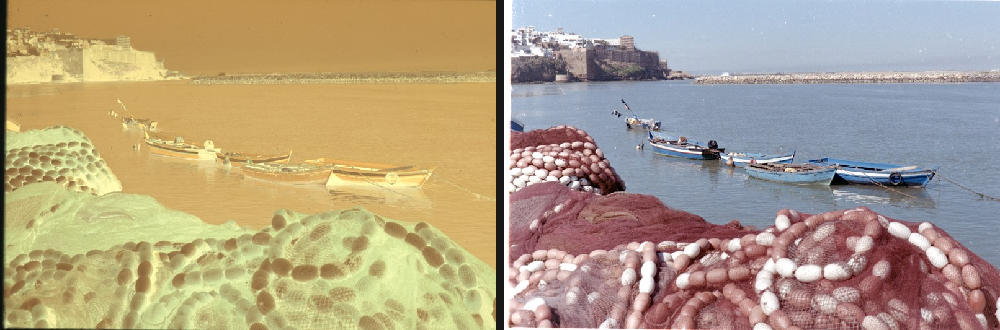
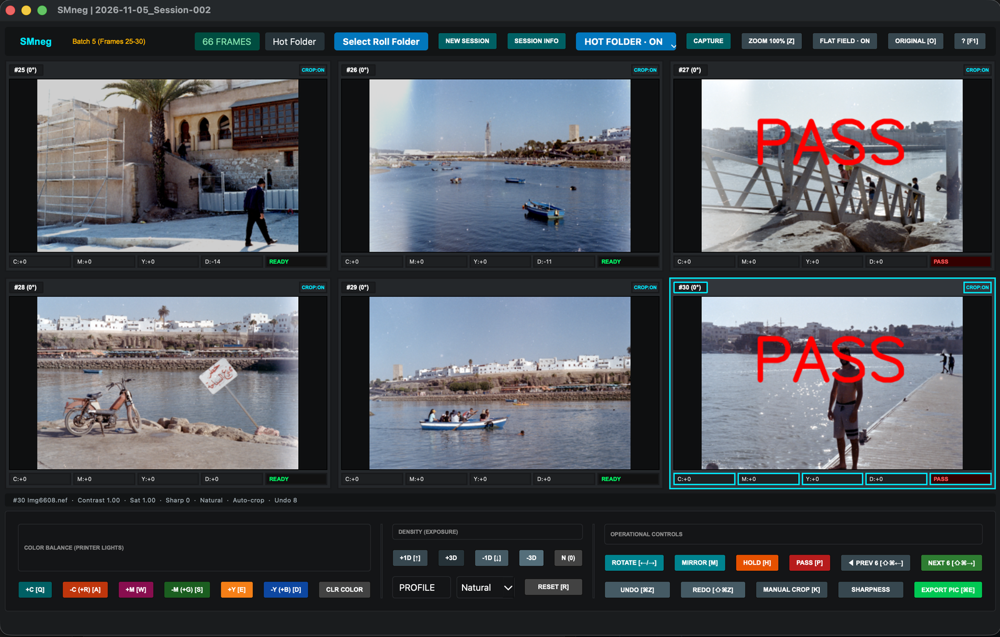
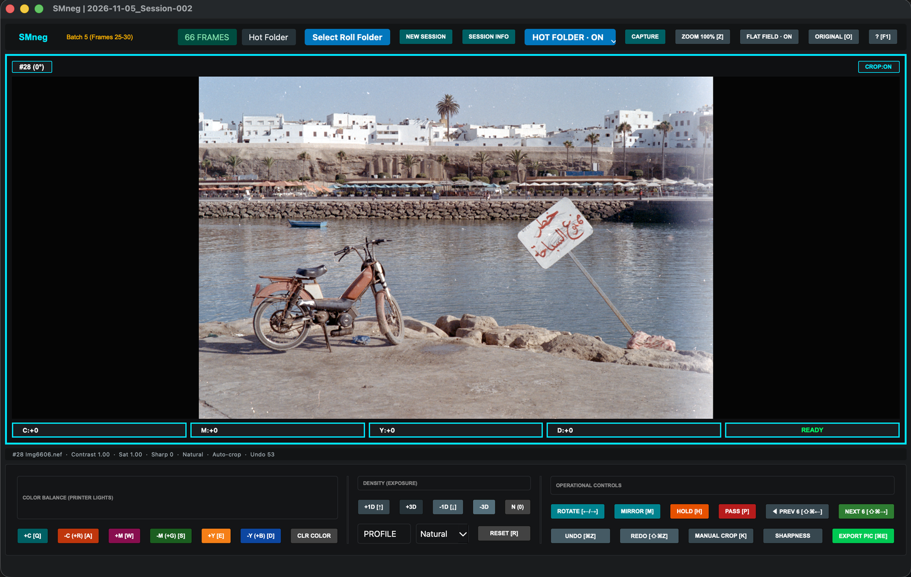
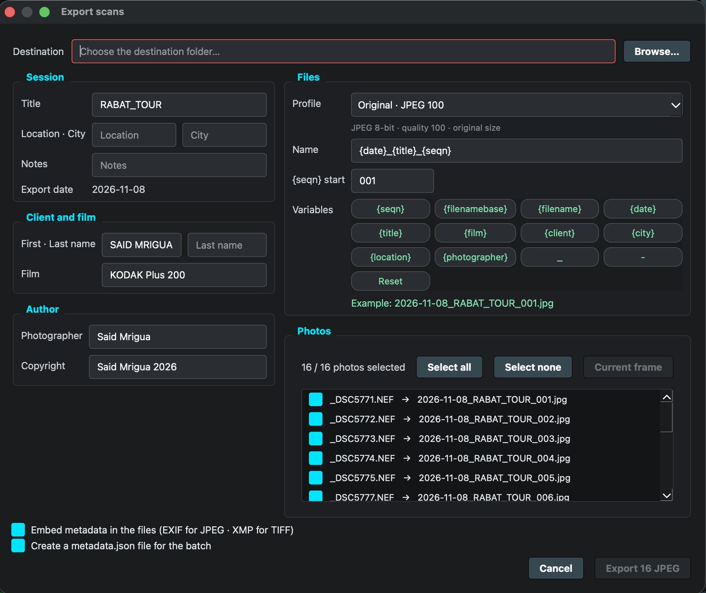
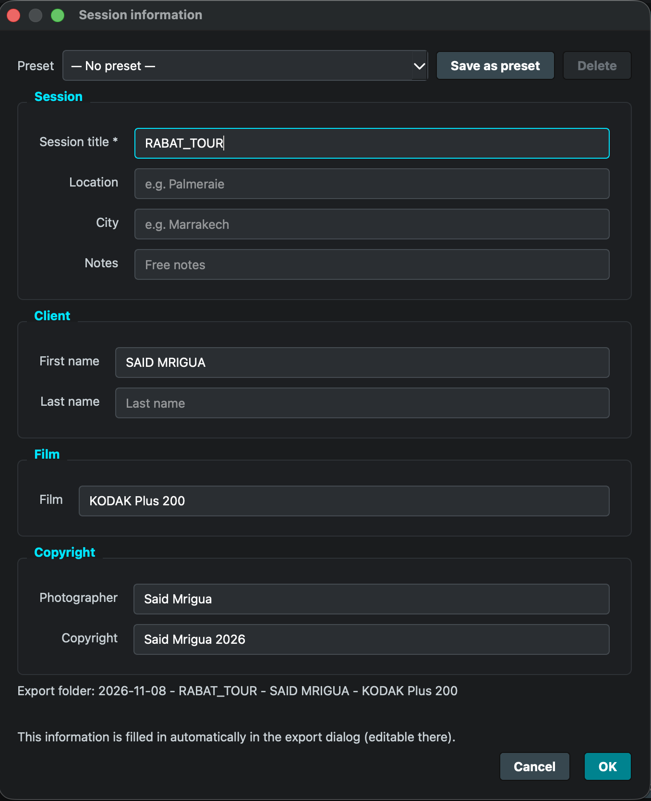
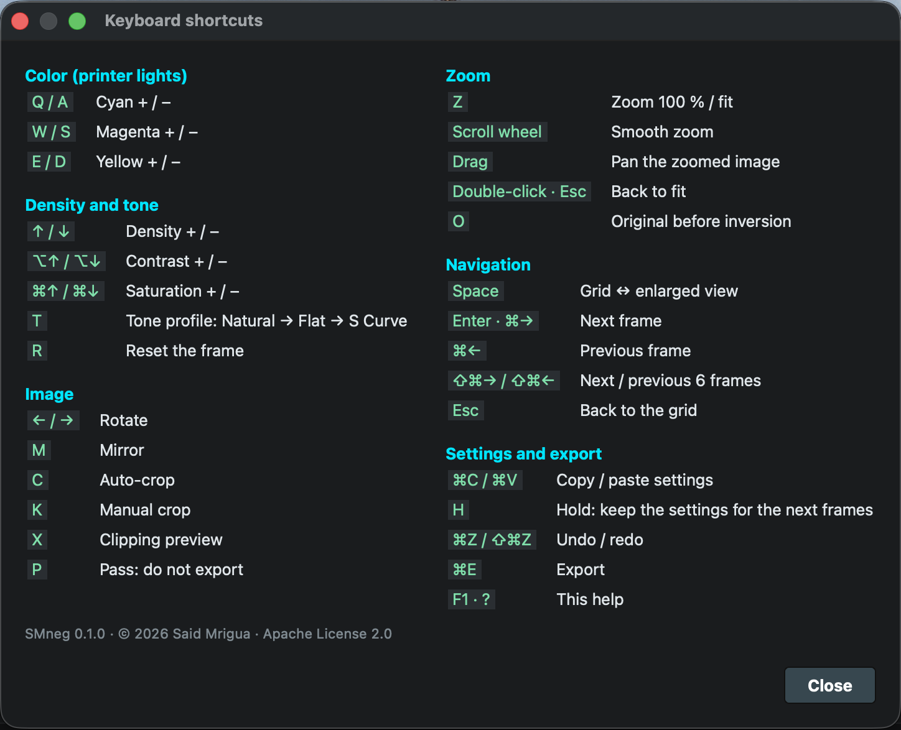

# SMneg

*SMneg = Said Mrigua negative.*

[](https://github.com/saidmrigua/SmNeg/actions/workflows/ci.yml)
[](LICENSE)


Invert camera-scanned film negatives (RAW, TIFF, JPEG or PNG) into positives, adjust them with a printer-lights style
color workflow, and export to JPEG or 16-bit TIFF with proper metadata.



<sub>Left: the negative as photographed (Nikon NEF, linear data). Right: SMneg result with default settings, no manual correction.
Photographs © 2026 Said Mrigua, all rights reserved (the code is Apache-2.0, the photographs are not).</sub>

More examples: [crates](docs/images/crates-before-after.jpg) · [building](docs/images/building-before-after.jpg)

Built for photographers who scan film with a digital camera. The workflow will feel familiar to people
who have used Frontier-style scanning controllers. SMneg is an independent project, not affiliated
with FUJIFILM or Nikon (see [NOTICE](NOTICE)).

**Contents:** [Features](#features) · [Screenshots](#screenshots) · [Download](#download) · [Quick start](#quick-start) ·
[Documentation](#documentation) · [Status and limits](#status-and-limits) · [Contributing](#contributing-and-support) · [License](#license)

## Features
- Density-based negative inversion engine (`engine.py`), RAW (`.raf .nef .nrw .dng`), TIFF and JPEG sources
- CMY / RGB color keys, density, contrast, saturation, tone profiles, sharpness, rotation, mirror, auto and manual crop
- In-place zoom with full-resolution decoding, flat-field (diffuser) correction, clipping preview
- Undo / redo, copy-paste settings, 6-frame navigation, keyboard help on `F1`
- Sessions: enter client / film / copyright information once at *New Session*; it pre-fills the export dialog
- Export to JPEG or 16-bit TIFF, Photo Mechanic style filename templates (`{filenamebase}_{seqn}`), embedded XMP/EXIF
  metadata, `metadata.json` sidecar, pipelined for speed
- Hot Folder watching; on macOS, optional capture trigger for Nikon NX Tether

## Screenshots



<sub>Grid view: six frames per page, printer-lights keys, density and tone controls. Frames marked PASS are skipped at export.</sub>

| Enlarged view | Export |
|---|---|
|  |  |

| Session information | Keyboard shortcuts |
|---|---|
|  |  |

## Download
Pre-built apps (macOS Apple Silicon `.dmg`, Windows x64 `.zip`), a wheel and an sdist are attached to every
[GitHub Release](https://github.com/saidmrigua/SmNeg/releases/latest). The apps are not code-signed, so the system asks
for confirmation the first time (macOS: *Open Anyway* in System Settings → Privacy & Security; Windows: *More info →
Run anyway*). Step by step: [docs/installation.md](docs/installation.md).

## Quick start
1. Install: the app from a [Release](https://github.com/saidmrigua/SmNeg/releases/latest), or from source:
   ```bash
   git clone https://github.com/saidmrigua/SmNeg.git smneg && cd smneg
   python -m venv .venv && source .venv/bin/activate      # Windows: .venv\Scripts\activate
   pip install -e ".[tiff]"        # "tiff" adds XMP metadata in 16-bit TIFF
   smneg                           # or: python -m smneg   or: python smneg.py
   ```
   Requires Python 3.10+. Details, Gatekeeper / SmartScreen steps: [docs/installation.md](docs/installation.md).
2. Click **NEW SESSION**, fill in the shoot information, then **Select Roll Folder** (or **HOT FOLDER**).
3. Adjust (`Q/A W/S E/D` color, `↑/↓` density), press `P` to skip a frame, `⌘E` to export.
   Full walk-through: [docs/workflow.md](docs/workflow.md).

**Supported files.** In: RAW (`.raf .nef .nrw .dng`), `.tif/.tiff`, `.jpg/.jpeg`, `.png`. Out: JPEG 8-bit or TIFF 16-bit with
EXIF/XMP metadata and an optional `metadata.json`. See [docs/file-formats.md](docs/file-formats.md).

**Privacy.** Everything runs locally. Nothing is sent over the network and there are no accounts or API keys.
Settings use Qt's `QSettings` under the name *SMneg*; each session keeps its data in `smneg-session.json` in its folder
(older `frontier-session.json` files still open).

## Documentation
Start at the [documentation index](docs/README.md):
[installation](docs/installation.md) · [workflow](docs/workflow.md) · [shortcuts](docs/shortcuts.md) ·
[file formats and metadata](docs/file-formats.md) · [troubleshooting](docs/troubleshooting.md) ·
[how it works](docs/how-it-works.md) · [development](docs/development.md) · [releasing](docs/releasing.md) ·
[changelog](CHANGELOG.md)

## Status and limits
SMneg 0.1.0 is a first public release (beta). It is used daily on macOS; Windows is expected to work but has not been
tested on real hardware yet (CI runs the non-GUI tests on both).

| | macOS | Windows |
|---|---|---|
| Inversion, zoom, export | yes | expected to work |
| Nikon NX Tether capture button | yes (needs Accessibility permission) | disabled |
| Pre-built app | `.dmg` for Apple Silicon only (Intel: run from source), not notarized | `.zip` (64-bit), not signed |

- 45 MP class frames need several GB of RAM (zoom caches the last full-resolution frame).
- RAW demosaicing speed is bounded by LibRaw; the inversion itself is parallelized.
- `window.py` is large; splitting it is planned. The interface has no automated GUI tests.
- Tested with PySide6 6.8, NumPy 2.2, Pillow 12, rawpy 0.27, OpenCV 5.0 on Python 3.10; the bounds in `pyproject.toml`
  are conservative.

## Tests
```bash
pip install -e ".[tiff,dev]" && QT_QPA_PLATFORM=offscreen pytest -q
```
154 tests. `tests/test_engine_golden.py` guards the inversion math against reference results; the others cover the
color pipeline, crop, flat-field, filename templates, sessions, settings migration, TIFF/XMP and the hot folder.

## Contributing and support
Bug reports, ideas and pull requests are welcome: [CONTRIBUTING.md](CONTRIBUTING.md) ·
[open an issue](https://github.com/saidmrigua/SmNeg/issues/new/choose) · [code of conduct](CODE_OF_CONDUCT.md) ·
[security policy](SECURITY.md). To cite SMneg, see [CITATION.cff](CITATION.cff).

## License
Code: Apache License 2.0, Copyright 2026 Said Mrigua. See [LICENSE](LICENSE) and [NOTICE](NOTICE).

Third-party libraries keep their own licenses: see [THIRD_PARTY_LICENSES.md](THIRD_PARTY_LICENSES.md).
The pre-built apps contain them.

Photographs in `docs/images/` are © 2026 Said Mrigua, all rights reserved. They are included to illustrate the
software and may not be reused without permission.

## Author
Said Mrigua, photographer, Morocco. [saidmrigua.com](https://saidmrigua.com/) · [@mrigua_said](https://www.instagram.com/mrigua_said/)
