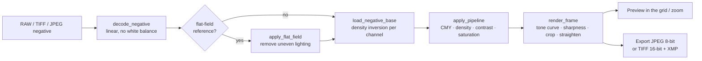

<!-- SPDX-License-Identifier: Apache-2.0 | Copyright 2026 Said Mrigua -->
# How SMneg works

SMneg turns a photograph of a film negative (taken with a digital camera) into a positive, then lets you
fine-tune it the way a printer-lights workflow does: cyan / magenta / yellow and density.

## 1. Decoding
RAW files (`.raf .nef .nrw .dng`) are decoded with LibRaw (through `rawpy`) as **linear 16-bit data with no
white balance, no auto brightness and no color conversion**, so the orange mask of a color negative is kept
and the inversion works on real sensor values. TIFF and JPEG sources are read with Pillow. Previews use a
half-size decode (at most 1600 px); full resolution is only decoded for export and for 100 % zoom.

## 2. Flat-field (optional)
A RAW of the bare light source (no film) can be used as reference. SMneg blurs it, normalizes it to its median
and multiplies each scan by the resulting gain map to remove vignetting and uneven backlight. It refuses
references that are over-exposed, too dark, or framed differently from the scan.

## 3. Density inversion (`engine.py`)
For each color channel independently:

1. **Film base level**: take the 99.5th percentile of the channel in the inner 20-80 % of the frame
   (the edges are ignored because of the holder and light leaks).
2. **Transmittance**: `t = clip(value / base, 1e-4, 1)`.
3. **Density**: `D = -log10(t)`, the optical density of the negative.
4. **Normalization**: map the 0.5th to 99.5th percentile of `D` (inner region) to 0..1.

The three channels are independent, so frames above 4 MP are computed in 3 parallel threads (the result is
bit-identical to the sequential one; a test checks it). This function is the core of the application and is
protected by `tests/test_engine_golden.py`.

## 4. Color pipeline (`apply_pipeline`)
Applied to the inverted base, in this order:

| Step | Formula |
|---|---|
| Gamma | `x ** (1 / 1.4)` |
| Cyan / magenta / yellow | gain `2 ** (-points * 0.04)` on the red / green / blue channel |
| Density | gain `2 ** (steps * 0.04)` on all channels |
| Contrast | `(x - 0.5) * contrast + 0.5` |
| Saturation | multiply S in HSV |
| Mirror, rotation (90° steps), auto-crop (5 % border) | geometric |

Then the window adds the tone profile (*Natural*, *Flat*, *S Curve*), sharpness, manual crop and
straightening. Because the pipeline is pure NumPy on the same base array, changing a key re-renders without
re-decoding the file.

## 5. Zoom
The grid shows small previews. In the enlarged view the image is drawn by a custom canvas
(`views.ImageCanvas`). Pressing `Z` (or scrolling) starts a background job that decodes and inverts the
full-resolution frame, then swaps it in without moving the image. The last full-resolution base is cached, so
zooming the same frame again is instant.

## 6. Sessions and settings
`New Session` asks for the shoot information once (title, client, film, location, copyright). It is stored
in `smneg-session.json` inside the session folder together with every frame's settings, and pre-fills the
export dialog. A *Hot Folder* can watch a directory (for example the folder NX Tether writes to) and import
files as soon as they are fully written. Undo / redo keeps a snapshot of the frame before each edit.

## 7. Export
`export.py` builds filenames from a template (`{filenamebase}_{seqn}`, `{date}`, `{city}` ...), writes JPEG
(EXIF) or 16-bit TIFF (XMP, needs `tifffile`) and a `metadata.json`. Loading the next frame, rendering the
current one and writing the previous one happen in parallel.

## Module map

| Module | Role |
|---|---|
| `app.py`, `__main__.py` | Entry point |
| `window.py` | Main window, keyboard handling, sessions, export orchestration |
| `engine.py` | Decoding, density inversion, color pipeline |
| `views.py` | Frame cards, enlarged view, zoomable canvas |
| `crop.py`, `zoom.py` | Manual crop dialog, original-image dialog |
| `flat_field.py`, `camera_reference.py` | Flat-field gain, camera-setting comparison |
| `export.py` | Export dialog, filename templates, TIFF/XMP writing, session information dialog |
| `session.py`, `settings.py` | Session files and `QSettings` (with migration from the old name) |
| `hot_folder.py`, `capture.py` | Folder watching, NX Tether trigger (macOS) |
| `help.py` | Shortcut list (F1) |
